# HandTop — Desktop in your hand

**A PC-style desktop for Android: windows, a taskbar, terminals and real Linux with its desktop apps.**
No root required. For phones, tablets and external screens, with or without Samsung DeX.

> [!WARNING]
> **Early version — 0.3.2 alpha.** HandTop is young and changes fast, so expect rough edges,
> bugs and things that will be reworked. So far it has been tested on one phone, a Samsung Galaxy
> S24 Ultra (Snapdragon 8 Gen 3). Ideas and bug reports are welcome, see [Support](#support).

## Vibe-coded

HandTop is a vibe-coding project by **Samson**. It is built by talking to an AI coding
agent, [Claude Code](https://claude.com/claude-code). The agent writes the code, the tests and these
docs. Samson sets the direction, tries every build on a real phone and decides what ships. The
commits name the AI as their co-author.

## Screenshots

| | |
|---|---|
| 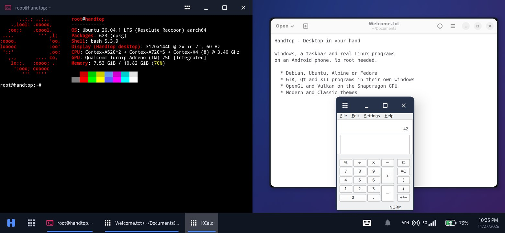 | 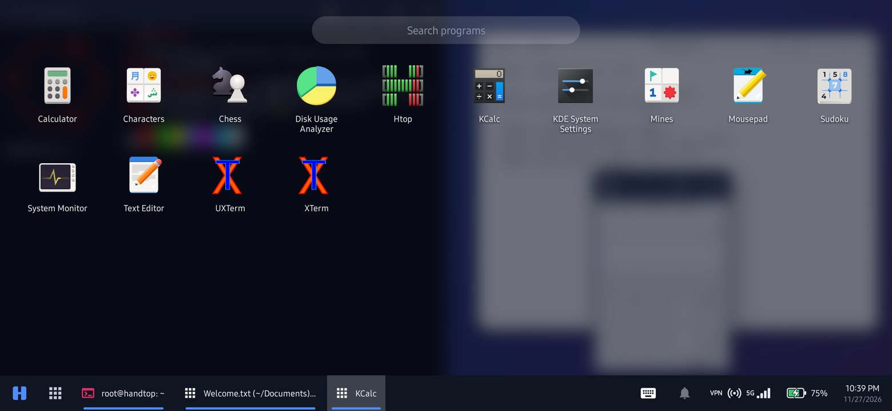 |
| Linux programs in their own windows: the terminal, GNOME Text Editor (GTK 4) and KCalc (Qt / KDE) | The full-screen launcher, with the programs' own icons |
| 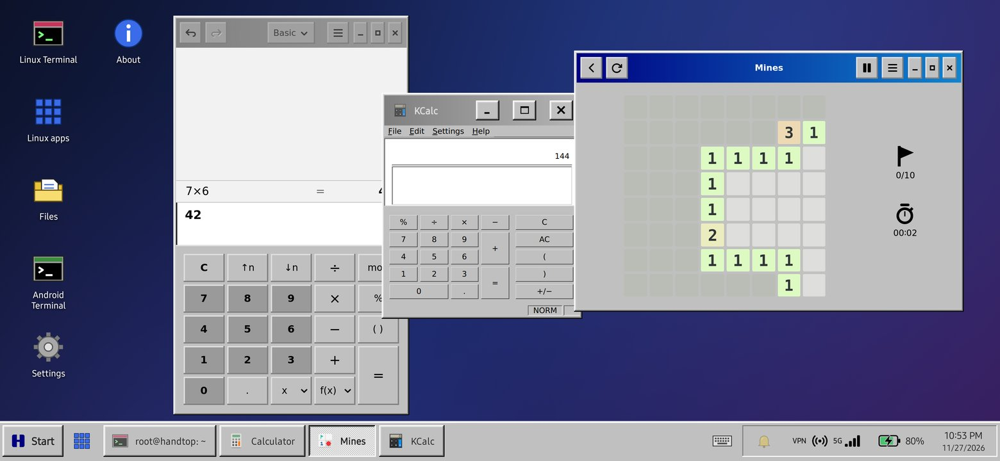 | 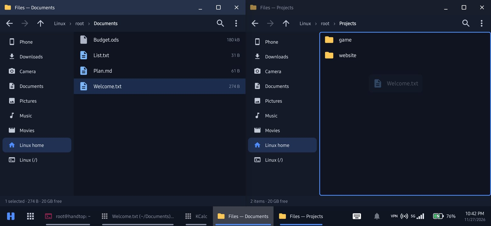 |
| The Classic theme reaches Linux programs too: GNOME Calculator, KCalc and Mines | Files: drag a file from one window into another |
| 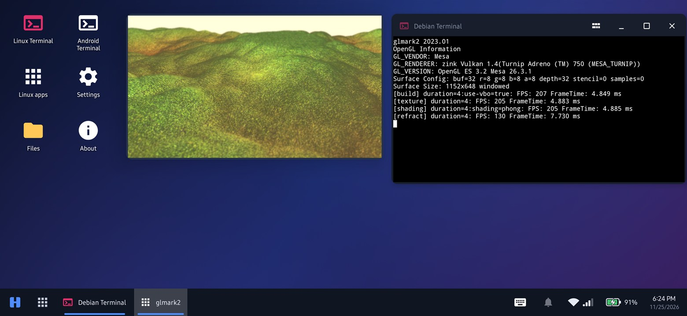 | 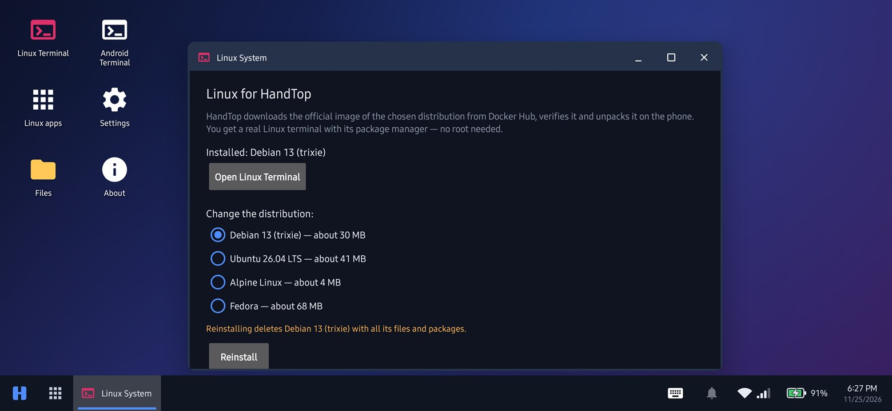 |
| 3D on the Adreno GPU: glmark2 through Mesa Turnip + Zink | Choose a distribution: Debian, Ubuntu, Alpine, Fedora |

### Well-known programs, on a monitor with Samsung DeX

Ubuntu 26.04 in HandTop on a Galaxy S24 Ultra, HandTop's window maximized in DeX. Left: the
Modern theme, right: the Classic theme.

| Modern | Classic |
|---|---|
| 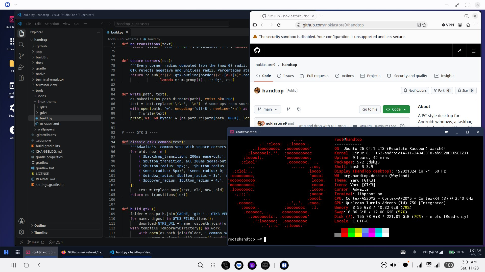 | 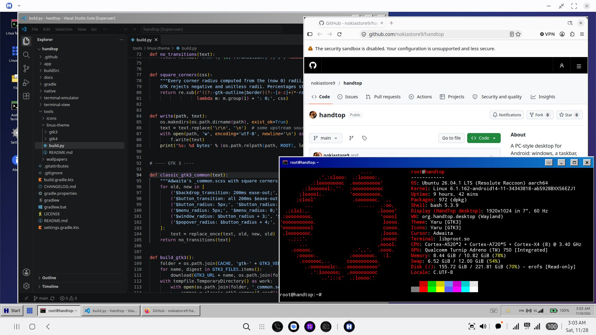 |
| Development: Visual Studio Code with HandTop's own source, Firefox and the terminal | |
| 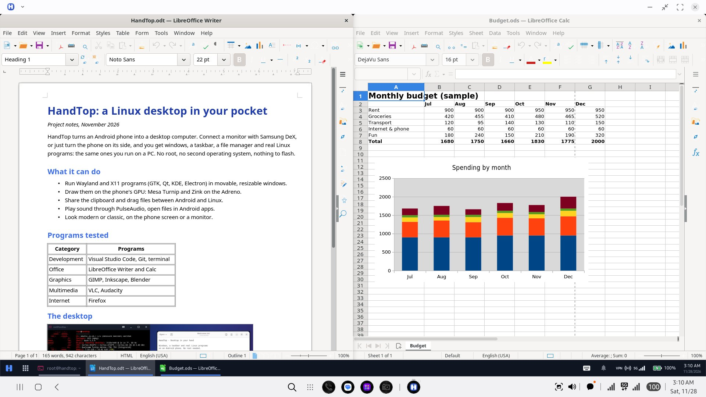 | 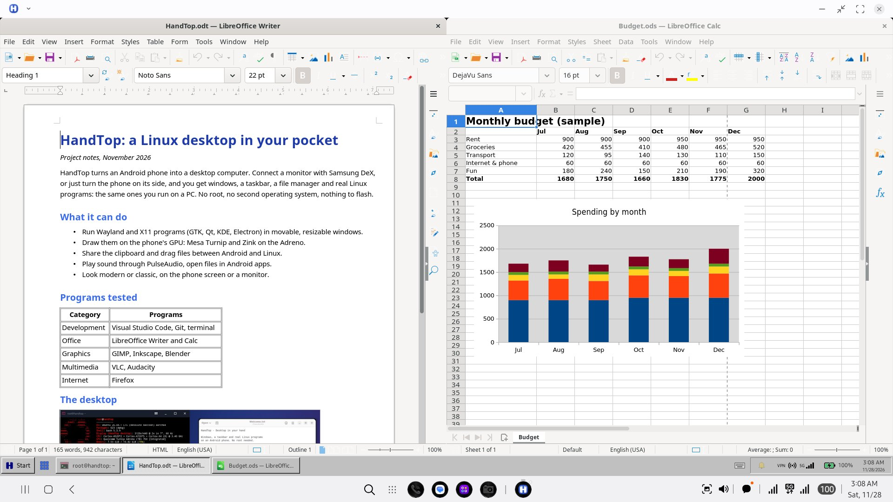 |
| Office: LibreOffice Writer and Calc side by side | |
| 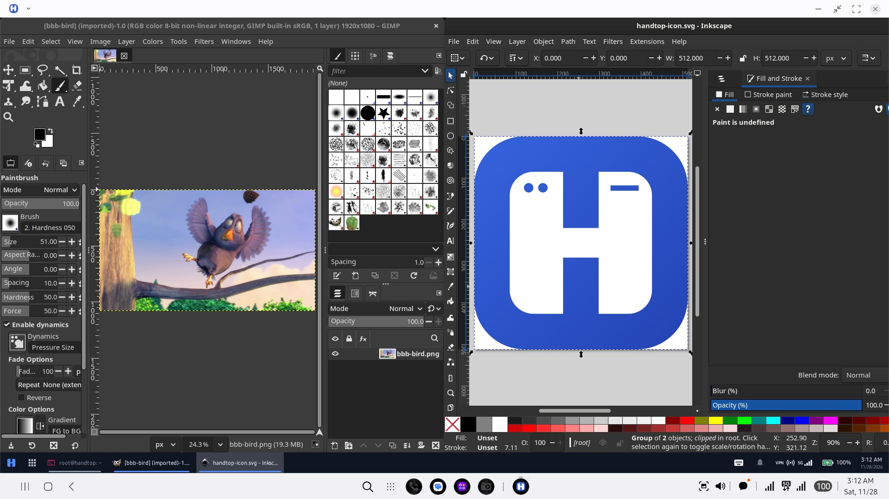 | 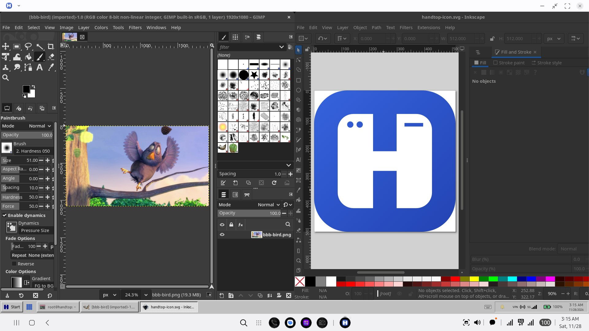 |
| Graphics: GIMP 3 and Inkscape | |
| 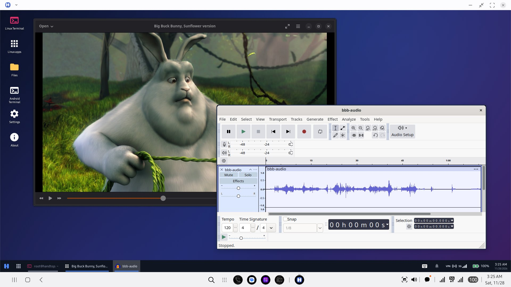 | 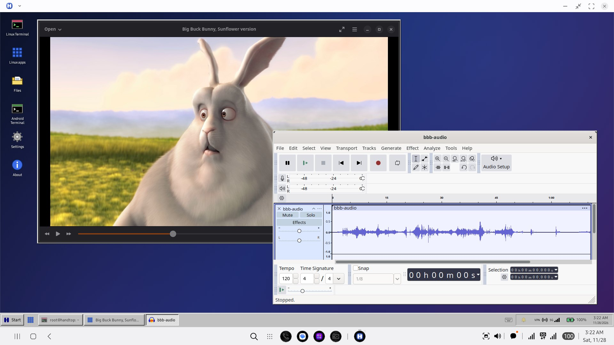 |
| Multimedia: Celluloid (mpv) playing Big Buck Bunny, Audacity | |
| 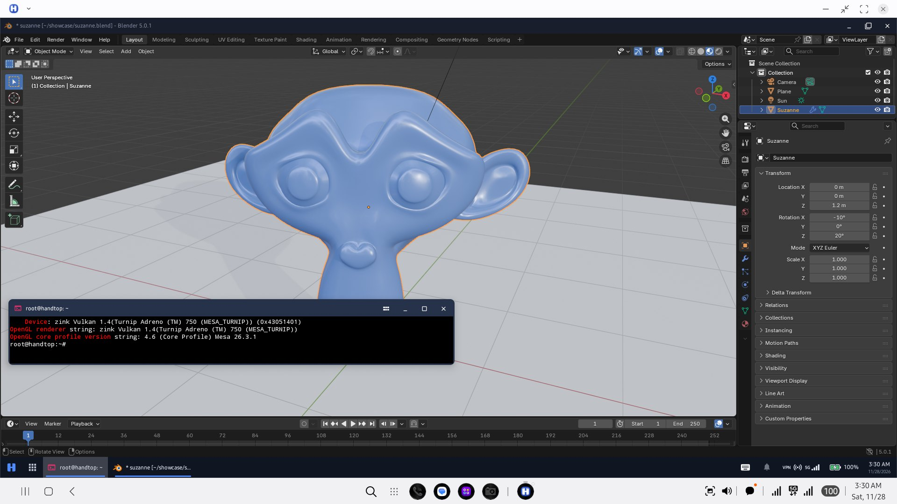 | 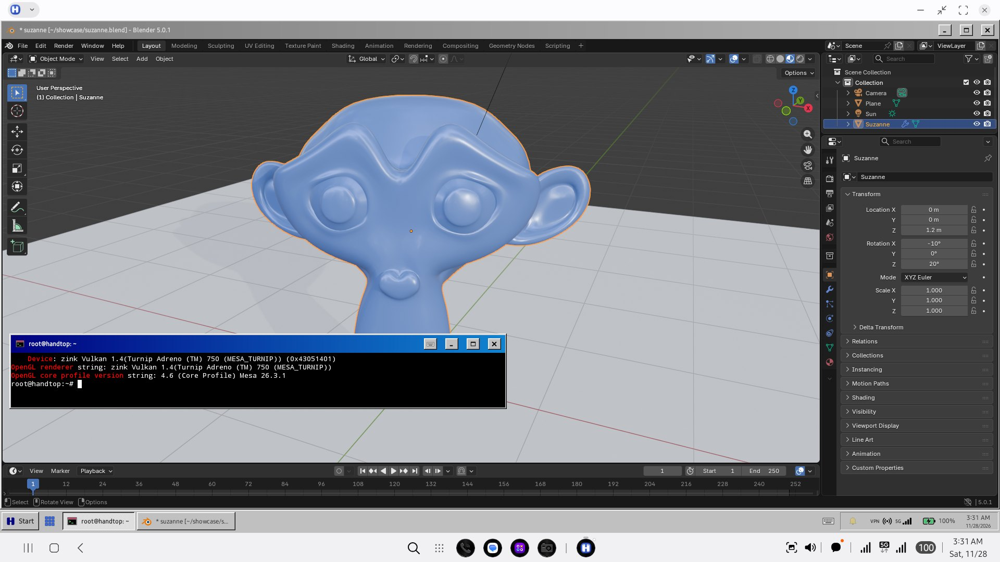 |
| 3D: Blender 5 on the Adreno GPU, OpenGL 4.6 through Zink on Turnip | |

Big Buck Bunny © Blender Foundation, [CC BY 3.0](https://creativecommons.org/licenses/by/3.0/).

## Install

1. Download `handtop-0.3.2-alpha.apk` from [Releases](https://github.com/nokiastore9/handtop/releases).
2. Open it on the phone. If Android asks, allow your browser or file manager to install apps.
3. Start HandTop and tap **Linux Terminal**, choose a distribution and tap **Install**. Linux is
   downloaded (4–68 MB) and sets itself up in a few minutes.

HandTop needs Android 8.0 or newer on a 64-bit ARM phone. GPU acceleration needs a Snapdragon
(Adreno) GPU. On Android 12 and newer, see Settings → Android about the background process limit.

## What works now

- Desktop with wallpapers (9 built-in or your own picture) and shortcuts you can add, remove and drag;
  taskbar with clock, start menu, notifications
- **Themes**: Modern (dark, translucent) or Classic — gray 3D windows, menus and controls, its own
  colour icons, no shadows, blur or animations (Settings → Desktop → Theme). The Classic theme
  reaches Linux programs too: GTK 2, GTK 3, GTK 4 and libadwaita, Qt 5/6 and KDE programs get gray
  bevelled controls and blue selection, on every distribution, without installing anything
- **Interface scale** from 50 to 130 %, separately for the phone screen (70 % at first) and for
  DeX or a monitor
- **The screen as a touchpad**, with a pointer: tap to click, hold for a right click or to drag,
  two fingers to scroll (long-press the keyboard button on the taskbar)
- Windows: drag, resize (mouse cursors on the frame), minimize, maximize,
  snap to the left / right half or full screen by dragging to the edge; a long press (or right
  click) on a window's taskbar button opens its menu
- **Linux Terminal** through proot as fake root, no root needed. One-tap install of an official
  Docker Hub image (sha256-verified): **Debian 13**, **Ubuntu 26.04 LTS**, **Alpine**, **Fedora** —
  with their package managers (`apt`, `apk`, `dnf`). Switch or remove it in Settings
- **Linux apps in their own windows**: HandTop is the Wayland compositor, X11 apps run through
  Xwayland; the clipboard is shared
- **Full-screen launcher** for Linux programs, with search and the programs' own icons
- **Sound** from Linux apps (PulseAudio inside Linux, played by Android)
- **GPU acceleration on Snapdragon** (Adreno): OpenGL 4.6, OpenGL ES 3.2 and Vulkan 1.4 through
  Mesa Turnip + Zink, shipped in the APK (see [native/mesa](native/mesa/README.md))
- **Linux sets itself up** after installing: GPU drivers, X11, sound and `gpg` on every
  distribution, with the progress on the taskbar
- **Files**: a file manager for the phone and Linux — drag files between windows, onto folders or
  onto the desktop, select several with a finger, search, KDE places; Linux file managers can open
  files in Android apps (`handtop-open`)
- **On-screen keyboard only when you touch a text field**, as on Android: not when a window opens
  with its field active or a program moves the focus
- **Keys the phone keyboard lacks** above it in Linux programs (Esc, Tab, Ctrl, Alt, Shift,
  arrows, Home/End, Page Up/Down, Delete; Ctrl then a letter makes a shortcut), and the keyboard
  sees the text around the caret in GTK and Qt programs for autocorrection and suggestions
- Phone storage in Linux as `/sdcard` (optional "All files access")
- Settings in categories: display, desktop, notifications, Linux, graphics and sound, Android
- Android Terminal (the system shell), several terminals at once
- Terminals keep running in the background (foreground service) and survive DeX switches
- Extra keys row (Esc, Tab, Ctrl, Alt, arrows…) — hidden when a hardware keyboard is attached
- Mouse: right-click menu, wheel scrolling, hover highlights
- Shortcuts: `Ctrl+Alt+T` new terminal, `Alt+F4` close, `Ctrl+Shift+C/V` copy/paste, `Ctrl +/-` font size

## Known limitations

- Tested on one phone so far (Galaxy S24 Ultra). Other phones, makers and Android versions have
  not been tried yet.
- GPU acceleration needs a Snapdragon (Adreno) GPU. On other phones Linux programs draw on the CPU,
  which is much slower.
- Frames of Linux programs are copied through shared memory (no zero-copy yet), so very light
  scenes stop at a few hundred FPS.
- Android 12 and newer may stop Linux processes in the background (the "phantom process killer").
  Settings → Android shows its status and how to turn it off.
- x86 Linux programs (box64) and Windows programs (Wine) are not supported yet.

## Support

Questions, bug reports and ideas:

- Email: [samsoft627@gmail.com](mailto:samsoft627@gmail.com)
- [GitHub issues](https://github.com/nokiastore9/handtop/issues)

## Version history

See [CHANGELOG.md](CHANGELOG.md).

## Roadmap

The detailed plan and notes are in [docs/ROADMAP.md](docs/ROADMAP.md) (in Russian).

1. Desktop shell + terminal ✔
2. Linux userland via proot: Debian / Ubuntu / Alpine / Fedora ✔ (optional chroot with root — to do)
3. Own Wayland compositor: every Linux app is a separate window on the desktop ✔
4. Xwayland ✔, clipboard ✔, sound ✔, file sharing
5. GPU acceleration (Turnip + Zink on Snapdragon) ✔, frames without copying, DeX polish
6. Themes: Modern and Classic ✔; a classic look for Linux programs (GTK / Qt / KDE) ✔, more themes
7. Gamepads; x86 programs (box64) and Windows programs (Wine)

## Building

Requirements: JDK 17+, Android SDK (platform 37, NDK 30.0.16138531). Works on Windows, Linux and macOS:
proot and its loader are compiled from `native/` by a Gradle task with plain NDK clang.

```sh
./gradlew assembleDebug
adb install -r app/build/outputs/apk/debug/app-debug.apk
```

`./gradlew assembleRelease` builds the release APK. It is signed when `keystore.properties` names a
key (see `app/build.gradle.kts`) and left unsigned otherwise.

## License

HandTop © 2026 Samson, under the [GNU GPL v3](LICENSE). Third-party code keeps its license:

- `terminal-emulator`, `terminal-view` — from [Termux](https://github.com/termux/termux-app), Apache 2.0
- `native/proot` — [termux/proot](https://github.com/termux/proot), GPL v2+
- `native/talloc` — [talloc](https://talloc.samba.org/), LGPL v3+
- `app/src/main/assets/linux-theme` — the classic theme for GTK (in the Classic and the Glossy colours), built by `tools/linux-theme` from the
  stylesheets of [GTK](https://gitlab.gnome.org/GNOME/gtk)'s Adwaita and [libadwaita](https://gitlab.gnome.org/GNOME/libadwaita), LGPL v2.1+
- [AndroidSVG](https://github.com/BigBadaboom/androidsvg) (a dependency) draws the SVG icons of Linux programs, Apache 2.0
